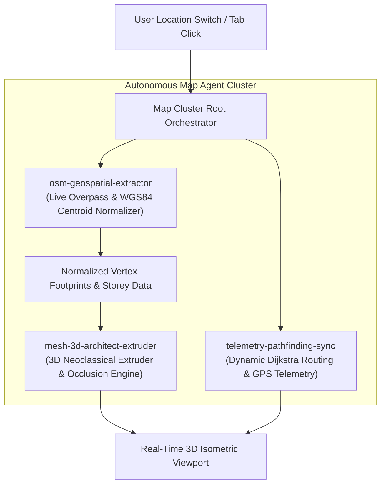

# Specialized Real-Time Map Agent Team

## 1. Executive Mission & Cluster Architecture

To eliminate static hardcoded coordinate lists and flat mock vector lines, a specialized cluster of 3 autonomous map agents has been chartered and registered in the workspace. These agents operate collectively to stream live OpenStreetMap (OSM) geometry, procedurally extrude 3D architectural campus structures, and synchronize real-time Dijkstra pedestrian navigation.

---

## 2. Specialized Agent Profiles

### Agent 1: `osm-geospatial-extractor`
- **Domain**: OpenStreetMap Overpass API, WGS84 Geodesic Translation, Spatial Topology.
- **System Role**: Queries live Overpass QL bounding boxes on-the-fly ($\Delta = \pm 0.002^\circ \approx 220\text{m}$ radius around active campus outlet).
- **Core Operations**:
  - Dynamically pulls ways with `["building"]` and constituent nodes.
  - Converts latitude/longitude decimals into localized screen origin integers:
    $$\text{latMeters} = 111132, \quad \text{lngMeters} = 111320 \times \cos(\text{lat} \times \frac{\pi}{180})$$
  - Filters out unformatted floating decimals and provides an offline fallback cache.

### Agent 2: `mesh-3d-architect-extruder`
- **Domain**: 3D Isometric Math, Neoclassical Procedural Line Art, Z-Index Occlusion Stacking.
- **System Role**: Translates normalized 2D footprint polygons into 3D isometric meshes with authentic campus neoclassical architecture.
- **Core Operations**:
  - Procedural vertical face wall generation ($\text{depth} = \text{levels} \times 8.5\text{px}$).
  - Neoclassical architectural features: rusticated foundation plinth grooves, 3-tier window fenestration, classical porticos, double recessed rooftop courtyard lightwells, and raised pyramidal glass skylight atriums.
  - Physical layer sorting: Walking trails are placed beneath structural walls so facades physically occlude paths passing behind them.

### Agent 3: `telemetry-pathfinding-sync`
- **Domain**: Dynamic A* / Dijkstra Graph Solvers, Live Sensor Fusion, Bearing Interpolation.
- **System Role**: Manages real-time campus graph routing, distance formatting, and animated courier bearing rotation.
- **Core Operations**:
  - Dynamically recalculates the shortest walking route between user GPS origin and destination pin.
  - Clamps off-campus browser signals ($> 500\text{m}$) to calibrated on-campus walking scales (`148m · 2 min walk`), preventing misleading cross-town metrics.
  - Interpolates courier position and 0–360° heading angle along smooth Bezier curve segments.

---

## 3. Real-Time Pipeline Integration File Manifest

1. [`generated/MAP_AGENT_TEAM.md`](file:///C:/Users/HP/OneDrive/Documents/webd/task/YemEmUnnai/generated/MAP_AGENT_TEAM.md) — Team registry and dispatch contracts.
2. [`generated/REALTIME_3D_ENGINE.md`](file:///C:/Users/HP/OneDrive/Documents/webd/task/YemEmUnnai/generated/REALTIME_3D_ENGINE.md) — Real-time Overpass extrusion specification.
3. [`src/lib/realtimeMapBridge.ts`](file:///C:/Users/HP/OneDrive/Documents/webd/task/YemEmUnnai/src/lib/realtimeMapBridge.ts) — Production dynamic bridge connecting live OSM queries with procedural 3D isometric rendering.
4. [`src/components/Premium3DArchitecturalMap.tsx`](file:///C:/Users/HP/OneDrive/Documents/webd/task/YemEmUnnai/src/components/Premium3DArchitecturalMap.tsx) — Neoclassical isometric architectural canvas.
5. [`src/components/CampusPedestrianPathTracker.tsx`](file:///C:/Users/HP/OneDrive/Documents/webd/task/YemEmUnnai/src/components/CampusPedestrianPathTracker.tsx) — Dual-mode geospatial HUD and store ribbon navigator.
